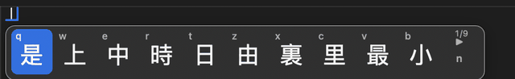

# Bihua IME — a stroke input method for macOS

English · [中文說明](README.md)

A Nokia-style five-stroke Chinese input method. **You type the stroke order of the
simplified form and it commits the traditional character.** Fully offline.



```
马 (simplified, 3 strokes) → 551        → 馬
国                         → 25112141   → 國
```

It is a real macOS input method (InputMethodKit), so it works everywhere — Safari,
Word, Excel, Terminal, chat apps — not just inside one application.

---

## Install (three steps)

1. **[⬇ Download the latest release](https://github.com/jacky7788/bihua-ime/releases/latest)** and unzip
2. Drag `BihuaIME.app` into `~/Library/Input Methods/`
   (in Finder press `⌘⇧G` and paste that path)
3. **Log out and back in once** — macOS builds the input-source list at login

Then pick **筆畫** from the input menu. If it is not there, use
`System Settings › Keyboard › Input Sources › Edit › + › Chinese, Traditional › 筆畫`.

> **Blocked by Gatekeeper?** The app is ad-hoc signed, so the first launch may be
> refused. Right-click `BihuaIME.app` › Open, or run:
> ```bash
> xattr -dr com.apple.quarantine ~/Library/Input\ Methods/BihuaIME.app
> ```

**Requirements:** macOS 13+ (tested on macOS 27, Apple silicon). Building from
source needs the Xcode Command Line Tools.

---

## Using it

### Keys

| Key | Action |
|---|---|
| `a` `s` `d` `f` `g` | 一 丨 丿 丶 乛 |
| `q` `w` `e` `r` `t` `z` `x` `c` `v` `b` | pick candidate 1–10 |
| `space` / `enter` | commit the highlighted candidate |
| `y` / `n` | previous / next candidate page |
| `backspace` / `esc` | delete one stroke / cancel |
| `←` `→` `↑` `↓` / `tab` | move inside the page |
| numpad `1`–`9` | also selects |

### Example: typing 中

```
s → g → a → s          (丨 乛 一 丨)
the input line shows:  丨乛一丨
a bar appears:         中 由 同 衕 跟 路 雖 跑 喝 足
press space or q    →  中
```

After committing 中 the bar turns into **next-character suggestions** (marked 聯
on the right):

```
中 → [q 國] [w 心] [e 央] [r 學] …   → press q for 國
```

And it chains: `中` → `國` → `家` in three presses.

### Typing English

- Turn on **Caps Lock** — the IME stops intercepting entirely
- or press `Shift` + letter for capitals

### You do not have to type every stroke

Candidates are ordered by corpus frequency, so two or three strokes already surface
the common characters:

```
a s   (一丨)   →  十 丁 都 地 去 …
s d   (丨丿)   →  小 省 少 師 歸 …
a s g (一丨乛) →  要 可 或 更 再 …
```

When your code is complete, the exact match always comes first — prefix matches
never push it out of the way.

---

## Configuration

`~/Library/Application Support/BihuaIME/config.json` (created on first run)

```json
{
  "strokeKeys": ["a", "s", "d", "f", "g"],
  "selectKeys": ["q", "w", "e", "r", "t", "z", "x", "c", "v", "b"],
  "prevKey": "y",
  "nextKey": "n",
  "fontSize": 24,
  "pageSize": 10,
  "showPreedit": true,
  "predict": true
}
```

| Field | Meaning |
|---|---|
| `strokeKeys` | five keys, in order: horizontal, vertical, left-falling, dot, turning |
| `selectKeys` | candidate keys, up to 10; must not overlap `strokeKeys` |
| `prevKey` / `nextKey` | page back / forward |
| `fontSize` | candidate bar font size (12–96) |
| `pageSize` | candidates per page (1–10) |
| `showPreedit` | show the stroke symbols inline while composing |
| `predict` | suggest the next character after committing |

Apply changes with `./reload.sh` (or `killall BihuaIME`).

**Want the original Nokia number pad?** Use `"strokeKeys": ["1","2","3","4","5"]`
and keep letters for `selectKeys`. The digits then become strokes, and the IME
intercepts them the way a pinyin IME intercepts letters.

---

## Troubleshooting

**筆畫 does not appear in the input menu**

1. Check that `~/Library/Input Methods/BihuaIME.app` exists
2. **Log out and back in** (restarting the app is not enough)
3. Otherwise add it: `System Settings › Keyboard › Input Sources › Edit › +`

**Typing does nothing and letters come through unchanged**

The system is not routing keys to the IME:

```bash
touch /tmp/bihua-debug      # enable logging
killall BihuaIME            # let the system relaunch it
# type a few characters, then:
cat /tmp/bihua.log
```

`handle` lines mean the IME received the key (a logic problem); an empty log means
the system never connected.

**Removing it completely**

```bash
killall BihuaIME
rm -rf ~/Library/Input\ Methods/BihuaIME.app
```

Then delete **筆畫** in `System Settings › Keyboard › Input Sources`.

---

## Building from source

```bash
git clone https://github.com/jacky7788/bihua-ime.git
cd bihua-ime
./build.sh       # compile + ad-hoc sign
./install.sh     # install into ~/Library/Input Methods
./use.sh         # switch the input source (run again to switch back)
./test.sh        # run the tests
```

`./build.sh` regenerates the code tables from the four files in `data/` (452 KB).
No network access and no Python packages are needed unless you change the data
sources (that requires `jieba`).

---

<details>
<summary><b>How it works</b> (data pipeline, ranking, gotchas)</summary>

### Pipeline

```
cnchar stroke names  →  5-stroke code  →  ┐
                                         ├→ code table (code → traditional char) → candidates (ranked by frequency)
OpenCC S→T mapping   ────────────────────┘
jieba two-char words ────────────────────────────────────→ next-character suggestions
```

### Sources

| Data | Used for | Licence |
|---|---|---|
| [cnchar](https://github.com/theajack/cnchar) | stroke names → 5-stroke codes (6939 chars) | MIT |
| [OpenCC](https://github.com/BYVoid/OpenCC) | simplified → traditional, plus the reverse table for variants | Apache-2.0 |
| [jieba](https://github.com/fxsjy/jieba) | character frequency, two-character words | MIT |

Stroke mapping: 横/提 → 1, 竖/竖钩 → 2, 撇 → 3, 点/捺 → 4, every other turning
stroke → 5.

Result: **6654 codes, 7274 output characters** (185 KB JSON) and a suggestion table
of 3499 heads / 18379 edges (135 KB).

Traditional variants (`為`/`爲`, `裡`/`裏`, `麵`/`麪`) are filled in from OpenCC's
reverse table `TSCharacters.txt` — a one-way simplified→traditional table only
emits one form per character, which leaves the other variant untypeable. Both load once at launch; there are no network
requests at runtime.

### Ranking

1. exact code match first
2. within a bucket or across prefixes → corpus frequency
3. traditional output borrows the frequency of its **simplified source** (國 uses
   the count for 国), so a simplified-dominant corpus does not bury traditional
   characters

### Bundle identifiers (for forks)

Measured on macOS 27, changing only the identifier on a byte-identical, re-signed
bundle:

| Identifier | Registers? |
|---|---|
| `com.bihua.inputmethod` (3 segments) | ❌ |
| `com.bihua.inputmethod.stroke` (4) | ✅ |
| `io.github.jacky7788.bihua` | ❌ even after a reboot |

Use at least four segments with a `com.` prefix, and log out/in after changing it.

</details>

## Known limitations

- Common characters only (6939 simplified sources); rare and traditional-only
  characters (e.g. 龜, 鬱) are not included yet
- Suggestions are character-to-character only, no multi-character phrases
- No punctuation conversion, no learning
- Candidates are keyboard-only — the bar cannot be clicked
- Ad-hoc signed: another machine needs a fresh `./build.sh`

## Licence

Code is MIT — see [LICENSE](LICENSE). Third-party data is credited in
[CREDITS.md](CREDITS.md).

Not affiliated with Apple.
