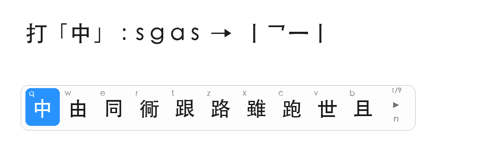
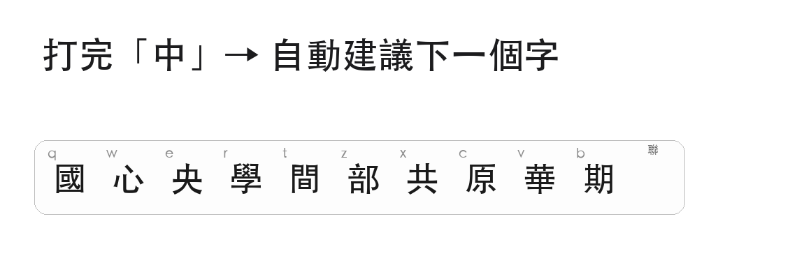

# 筆畫輸入法（macOS）

[English](README.en.md)

諾基亞式五筆畫輸入法，**用簡體筆順打字，出繁體字**。純本地、無網絡、ad-hoc 簽名。

## 係咩樣

打「中」——`s` `g` `a` `s`（丨乛一丨）：



打完之後，候選窗自動換成下一個字嘅建議（右上角「聯」）：



> 上圖係按實際渲染參數重畫嘅示意圖（字型、尺寸、顏色同 `CandidateCanvas.swift` 一致）。
> 喺你部機上面，候選窗會喺打字位置下面彈出。

## 下載

**[⬇ 下載最新版](https://github.com/jacky7788/bihua-ime/releases/latest)**（`BihuaIME-x.y.z.zip`）

1. 解壓，將 `BihuaIME.app` 拖入 `~/Library/Input Methods/`
2. **登出再登入一次**（macOS 喺登入時才建立輸入法選單）
3. 選單列輸入法圖示 → **筆畫**

ad-hoc 簽名，第一次開可能被 Gatekeeper 攔：右撳 › 打開，或者執行
`xattr -dr com.apple.quarantine ~/Library/Input\ Methods/BihuaIME.app`。

想自己編譯就睇下面「點裝」。

```
打「马」嘅筆順 551  →  出「馬」
打「国」嘅筆順     →  出「國」
```

---

## 一、點裝

```bash
git clone https://github.com/<you>/bihua-ime.git
cd bihua-ime
./build.sh        # 編譯（第一次已經做過）
./install.sh      # 複製到 ~/Library/Input Methods
```

裝完之後揀輸入法：**⌃⌥Space** 或者選單列右上角輸入法圖示 → **筆畫**。

快捷指令：

```bash
./use.sh          # 直接切去「筆畫」，再執行一次切返
```

---

## 二、點用

| 按鍵 | 作用 |
|---|---|
| `a` `s` `d` `f` `g` | 一 丨 丿 丶 乛 |
| `空白` / `Enter` | 確認而家選中嗰個字 |
| `q` `w` `e` `r` `t` `z` `x` `c` `v` `b` | 揀第 1–10 個候選字（同原版一樣） |
| `y` / `n` | 上一頁 / 下一頁候選（等於原版 ◀ ▶） |
| 小鍵盤 `1`–`9` | 一樣揀得（慣用右手嘅話） |
| `↑` `↓` / `←` `→` / `Tab` | 移動選擇 |
| `Backspace` | 刪一個筆畫 |
| `Esc` | 取消 |

> **打英文**：`Shift` + 字母出大寫；或者開 **Caps Lock**（輸入法會完全唔攔，等於英文模式）。

例子——打「中」：

```
s → g → a → s   （丨 乛 一 丨）
畫面見到：丨乛一丨
撳空白 → 中
```

打「馬」（用簡體「马」嘅筆順，3 畫）：

```
g → g → a → 空白   →   馬
```

呢個就係「簡入繁出」：**你打嘅係簡體字嘅筆順，出嚟嘅係繁體字**。所以「国」5 畫就出到「國」，「这」7 畫就出到「這」。

**候選窗**會喺打字位置下面彈出，大字顯示，左上角有細細嘅序號。

---

## 三、自訂鍵位

設定檔：`~/Library/Application Support/BihuaIME/config.json`

```json
{
  "strokeKeys": ["a", "s", "d", "f", "g"],
  "selectKeys": ["q", "w", "e", "r", "t", "z", "x", "c", "v", "b"],
  "prevKey": "y",
  "nextKey": "n",
  "fontSize": 24,
  "pageSize": 10,
  "showPreedit": true
}
```

想用諾基亞式數字鍵？將 `strokeKeys` 改做 `["1","2","3","4","5"]` 就得（咁數字就唔可以揀字，要用空白或者小鍵盤）。

- `strokeKeys` — 五個鍵，順序係 橫 豎 撇 點 折。可以用字母、數字、標點都得。
- `selectKeys` — 揀字鍵，第 1 個鍵揀第 1 個候選，最多 10 個。**唔可以同 `strokeKeys` 撞**（撞咗以筆畫為先）。
- `prevKey` / `nextKey` — 上一頁／下一頁候選。候選窗左邊會顯示 `◀ y`、右邊 `▶ n`，中間顯示頁碼（例如 `2/7`）。
- `fontSize` — 候選窗字體大細（12–96）。
- `pageSize` — 一頁顯示幾多個候選字（1–9）。
- `showPreedit` — 打緊字時喺輸入位顯示筆畫符號。

改完之後：

```bash
./reload.sh
```

> 而家筆畫係字母、揀字又係字母，所以**數字鍵 0–9 完全唔會被攔**，可以照打數字。
> 想改返諾基亞原味（`1`–`5` 做筆畫）：將 `strokeKeys` 改做 `["1","2","3","4","5"]`，
> 同時將 `selectKeys` 改做 `["q","w","e","r","t","y","u","i","o"]` 或留空。

---

## 四、疑難排解

**選單列見唔到「筆畫」**

系統設定 › 鍵盤 › 輸入方式 › 編輯… › `+` › 揀「繁體中文」或者最底嘅「其他」› **筆畫** › 加入。

**打咗字冇反應，數字直接出返嚟**

代表系統冇將按鍵交去輸入法。依次試：

```bash
touch /tmp/bihua-debug     # 開啟除錯記錄
killall BihuaIME           # 等系統重新起
cat /tmp/bihua.log         # 再打幾個字，睇有冇 handle 記錄
```

有 `handle` 記錄 = 輸入法收到鍵但邏輯有問題；冇記錄 = 系統根本冇接通。

**候選窗位置怪**

`cat /tmp/bihua.log` 睇吓，或者改 `fontSize` 細啲再試。

**改咗 bundle ID 之後輸入法消失**

macOS 對輸入法嘅 bundle ID 有兩個實測到嘅限制（macOS 27）：

- **一定要四段或以上**：`com.bihua.inputmethod`（三段）註冊唔到，`com.bihua.inputmethod.stroke`（四段）即刻得
- **`io.github.*` 一律註冊唔到**：連 `includeAllInstalled` 都見唔到，重啟整部機都冇用

所以改 ID 請用 `com.<專案>.<功能>.<名>` 呢個形狀。改完之後 **要登出再登入一次**，輸入方式清單才會更新。

**想完全移除**

```bash
killall BihuaIME
rm -rf ~/Library/Input\ Methods/BihuaIME.app
# 再去 系統設定 › 鍵盤 › 輸入方式 刪走「筆畫」
```

---

## 五、專案結構

```
bihua-ime/
├── Sources/             Swift 原始碼
│   ├── main.swift               IMKServer 啟動 + --selftest
│   ├── BihuaInputController.swift  按鍵處理、預輸入、commit
│   ├── BihuaEngine.swift        編碼表查詢
│   ├── BihuaConfig.swift        設定檔
│   └── CandidatePanel.swift     浮動候選窗
├── Test/                headless 輸入流程測試
├── TestApp/             端到端測試 app（會開窗口）
├── tools/
│   ├── build_codes.py   建編碼表
│   └── make_icons.py    生成圖示
├── data/
│   ├── cnchar-5stroke.json   官方筆順 → 五筆碼（6939 字）
│   ├── STCharacters.txt      OpenCC 簡繁對照
│   └── graphics.txt          makemeahanzi 筆順座標（備用）
├── build.sh / install.sh / test.sh / reload.sh / use.sh
└── build/               產出物（BihuaIME.app 等）
```

## 六、資料來源

- **筆順 → 五筆碼**：`cnchar-order`（筆順名稱權威資料，6939 個常用字）。名稱 → 五筆碼嘅對應：
  橫/提→1，豎/豎鈎→2，撇→3，點/捺→4，其餘所有折筆→5。
- **簡 → 繁**：[OpenCC](https://github.com/BYVoid/OpenCC) `STCharacters.txt`。
- **字頻**：[jieba](https://github.com/fxsjy/jieba) 嘅 `dict.txt`（11580 個單字詞頻），用嚟排候選先後。
- 最終碼表：**6654 個碼，7176 個可輸出漢字**，全部喺一個 184 KB 嘅 JSON 入面，開機載入。

### 聯想（打完一個字，建議下一個字）

打完一個字之後，候選窗會自動彈出**下一個字**嘅建議，右上角有「**聯**」字做記認：

```
打完「中」  →  [q 國] [w 心] [e 央] [r 學] [t 間] …    聯
打完「時」  →  [q 間] [w 候] [e 期] [r 代] [t 刻] …    聯
```

撳 `q`–`b` 就直接出嗰個字（唔使再打筆畫），而且會**連鎖**——例如 `中` → `國` → `家`。

- 唔想用就照打筆畫，聯想會自動收埋
- `Esc` 收埋；8 秒冇動作都會自動收
- 想關閉：`config.json` 設 `"predict": false`

聯想表係由 jieba 詞典 11 萬個兩字詞抽出嚟（`我`→`們`、`時`→`間`、`不`→`是`），共 3499 個起首字、18379 條，135 KB。

### 候選排序

1. **完全吻合嘅碼優先**（打齊筆畫嗰個字一定排第一）
2. 同一個碼有幾個字 → 按**常見度**排
3. 前綴吻合（你未打齊）→ 一樣按常見度排

所以打兩三筆就已經可以揀到最常用嗰堆字，唔使打齊。例如打 `251`：

```
口 是 中 時 日 由 裏 里 最 …
```

第一個「口」係完全吻合，之後就係最常用嘅前綴字。

## 七、已知限制

- 只覆蓋常用字（6939 個簡體字源）。生僻字、部分純繁體字（例如「龜」「鬱」）暫時打唔到。
- 冇詞組聯想、冇標點自動轉換、冇學習功能。
- ad-hoc 簽名，換機要重新 `./build.sh`。
- 候選窗唔可以撳滑鼠（只可以鍵盤揀）。

## 八、測試

```bash
./test.sh
```

- 引擎測試：碼表載入、完全吻合 / 前綴查詢。
- 輸入流程測試：用假 client 模擬按鍵，驗證預輸入、退格、Esc、小鍵盤揀字、⌘ 組合鍵、繁簡轉換。
