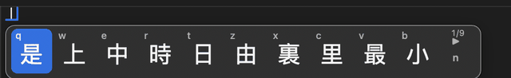

# 筆畫輸入法（macOS）

[English](README.en.md)

諾基亞式五筆畫輸入法。**打簡體字嘅筆順，出繁體字。** 純本地、無網絡。



```
打「马」嘅筆順 551        →  馬
打「国」嘅筆順 25112141   →  國
```

係一個真正嘅 macOS 系統輸入法（InputMethodKit），所以 Safari、Word、Excel、
Terminal、WhatsApp 全部用得，唔係得一個 app 用得到。

---

## 點裝（三步）

1. **[⬇ 下載最新版](https://github.com/jacky7788/bihua-ime/releases/latest)**，解壓
2. 將 `BihuaIME.app` 拖入 `~/Library/Input Methods/`
   （Finder 按 `⌘⇧G`，貼上呢個路徑就開到）
3. **登出再登入一次** —— macOS 喺登入時才建立輸入法清單

登入後：選單列輸入法圖示 → **筆畫**。如果冇見到，去
`系統設定 › 鍵盤 › 輸入方式 › 編輯 › + › 繁體中文 › 筆畫`。

> **被 Gatekeeper 攔住？** 個 app 係 ad-hoc 簽名，第一次開可能彈「無法打開」。
> 右撳 `BihuaIME.app` › 打開，或者執行：
> ```bash
> xattr -dr com.apple.quarantine ~/Library/Input\ Methods/BihuaIME.app
> ```

**系統要求**：macOS 13 或以上（喺 macOS 27 / Apple silicon 實測）。
自己編譯就要 Xcode Command Line Tools。

---

## 點用

### 按鍵

| 按鍵 | 作用 |
|---|---|
| `a` `s` `d` `f` `g` | 一 丨 丿 丶 乛 |
| `q` `w` `e` `r` `t` `z` `x` `c` `v` `b` | 揀第 1–10 個候選字 |
| `空白` / `Enter` | 確認而家選中嗰個 |
| `y` / `n` | 上一頁 / 下一頁候選 |
| `Backspace` / `Esc` | 刪一個筆畫 / 取消 |
| `↑` `↓` `←` `→` / `Tab` | 喺本頁內移動 |
| 小鍵盤 `1`–`9` | 一樣揀得 |

### 例子：打「中」

```
s → g → a → s          （丨 乛 一 丨）
輸入位見到：丨乛一丨
下面彈出：中 由 同 衕 跟 路 雖 跑 喝 足
撳 空白 或 q  →  中
```

打完「中」之後，候選窗會自動換成**下一個字**嘅建議（右上角有「聯」字）：

```
中 → [q 國] [w 心] [e 央] [r 學] …      → 撳 q 出「國」
```

而且會連鎖：`中` → `國` → `家`，三下 `q` 打完。

### 打英文

- 開 **Caps Lock** —— 輸入法完全唔攔，等於英文模式
- 或者 `Shift` + 字母，出大寫

### 唔使打齊筆畫

候選字按**常見度**排。打兩三筆就已經見到最常用嗰堆字：

```
打 a s  （一丨）  →  十 丁 都 地 去 …
打 s d  （丨丿）  →  小 省 少 師 歸 …
打 a s g（一丨乛）→  要 可 或 更 再 …
```

打齊全碼嘅時候，完全吻合嗰個字一定排第一，唔會被前綴字搶位。

---

## 設定

設定檔：`~/Library/Application Support/BihuaIME/config.json`（第一次執行會自動生成）

```json
{
  "strokeKeys": ["a", "s", "d", "f", "g"],
  "selectKeys": ["q", "w", "e", "r", "t", "z", "x", "c", "v", "b"],
  "prevKey": "y",
  "nextKey": "n",
  "fontSize": 24,
  "pageSize": 10,
  "showPreedit": true,
  "predict": true
}
```

| 欄位 | 意思 |
|---|---|
| `strokeKeys` | 五個鍵，順序係 橫 豎 撇 點 折。字母、數字、標點都得 |
| `selectKeys` | 揀字鍵，第 1 個揀第 1 個候選，最多 10 個。唔可以同 `strokeKeys` 撞 |
| `prevKey` / `nextKey` | 上一頁 / 下一頁 |
| `fontSize` | 候選窗字體（12–96） |
| `pageSize` | 一頁幾多個候選（1–10） |
| `showPreedit` | 打緊字時喺輸入位顯示筆畫符號 |
| `predict` | 打完一個字之後建議下一個字 |

改完之後執行 `./reload.sh`（或者 `killall BihuaIME`）就會生效。

**想用諾基亞原味數字鍵？**

```json
{
  "strokeKeys": ["1", "2", "3", "4", "5"],
  "selectKeys": ["q", "w", "e", "r", "t", "z", "x", "c", "v", "b"]
}
```

咁 `1`–`5` 就係筆畫，數字鍵會被輸入法攔（同打拼音食咗英文字母一樣）。

---

## 常見問題

**選單列見唔到「筆畫」**

1. 確認 `~/Library/Input Methods/BihuaIME.app` 真係存在
2. **登出再登入**（唔係淨係重開 app）
3. 仲冇 → `系統設定 › 鍵盤 › 輸入方式 › 編輯 › + › 繁體中文 › 筆畫`

**打咗字冇反應，字母直接出返嚟**

代表系統冇將按鍵交去輸入法：

```bash
touch /tmp/bihua-debug      # 開啟除錯記錄
killall BihuaIME            # 等系統重新起
# 再打幾個字，然後：
cat /tmp/bihua.log
```

有 `handle` 記錄 = 輸入法收到鍵（邏輯問題）；完全冇 = 系統未接通。

**候選窗位置怪**

改細 `fontSize` 再試；或者 `cat /tmp/bihua.log` 睇實際座標。

**想完全移除**

```bash
killall BihuaIME
rm -rf ~/Library/Input\ Methods/BihuaIME.app
```

再去 `系統設定 › 鍵盤 › 輸入方式` 刪走「筆畫」。

---

## 自己編譯

```bash
git clone https://github.com/jacky7788/bihua-ime.git
cd bihua-ime
./build.sh       # 編譯 + ad-hoc 簽名
./install.sh     # 裝入 ~/Library/Input Methods
./use.sh         # 切換去「筆畫」（再執行一次切返）
./test.sh        # 跑測試
```

`./build.sh` 會由 `data/` 四個檔（452 KB）重新生成字表，唔需要網絡、唔需要裝 Python 套件
（除非你要改資料源，先要 `jieba`）。

---

<details>
<summary><b>技術細節</b>（點解係咁、資料邊嚟）</summary>

### 資料流程

```
cnchar 筆順名稱  →  五筆碼  →  ┐
                              ├→  碼表（code → 繁體字）  →  候選（按字頻排）
OpenCC 簡繁對照  ─────────────┘
jieba 兩字詞     ──────────────────────────────→  聯想（字 → 下一個字）
```

### 資料來源

| 資料 | 用途 | 授權 |
|---|---|---|
| [cnchar](https://github.com/theajack/cnchar) | 筆順名稱 → 五筆碼（6939 個簡體字） | MIT |
| [OpenCC](https://github.com/BYVoid/OpenCC) | 簡 → 繁對照 | Apache-2.0 |
| [jieba](https://github.com/fxsjy/jieba) | 單字頻率、兩字詞（聯想） | MIT |

筆形對應：橫/提 → 1，豎/豎鈎 → 2，撇 → 3，點/捺 → 4，其餘所有折筆 → 5。

最終碼表：**6654 個碼、7176 個可輸出漢字**（184 KB JSON）；聯想表 3499 個起首字、
18379 條（135 KB）。兩者開機載入一次，runtime 冇網絡請求。

### 候選排序

1. 完全吻合嘅碼優先
2. 同碼或前綴之間 → 按語料字頻排
3. 繁體輸出用**簡體來源字**嘅頻率（`國` 用 `国` 嘅次數），所以唔會被簡體語料拖低

### 專案結構

```
bihua-ime/
├── Sources/          Swift：IMKServer、輸入控制器、候選窗、碼表、設定
├── Test/             headless 輸入流程測試（假 client 模擬按鍵）
├── TestApp/          端到端測試用嘅小窗口 app
├── tools/            build_codes.py / build_predict.py / make_icons.py
├── data/             碼表原料（cnchar 五筆碼、OpenCC 對照、字頻、聯想表）
└── build.sh install.sh test.sh reload.sh use.sh
```

### 開發者注意：bundle ID

macOS 27 實測（只改 ID、同一個 bundle、同一份簽名）：

| Bundle ID | 註冊到？ |
|---|---|
| `com.bihua.inputmethod`（三段） | ❌ |
| `com.bihua.inputmethod.stroke`（四段） | ✅ |
| `io.github.jacky7788.bihua` | ❌ 重啟都冇用 |

所以改 ID 要用**四段以上、`com.` 開頭**，改完要登出登入一次。

</details>

## 已知限制

- 只覆蓋常用字（6939 個簡體字源）；生僻字同部分純繁體字（例如「龜」「鬱」）暫未收錄
- 聯想只做單字接單字，未做多字詞
- 冇標點自動轉換、冇學習功能
- 候選窗只可以用鍵盤揀，唔可以撳滑鼠
- ad-hoc 簽名，換機要重新 `./build.sh`

## 授權

程式碼 MIT，見 [LICENSE](LICENSE)。第三方資料授權見 [CREDITS.md](CREDITS.md)。

同 Apple 冇任何關係。
